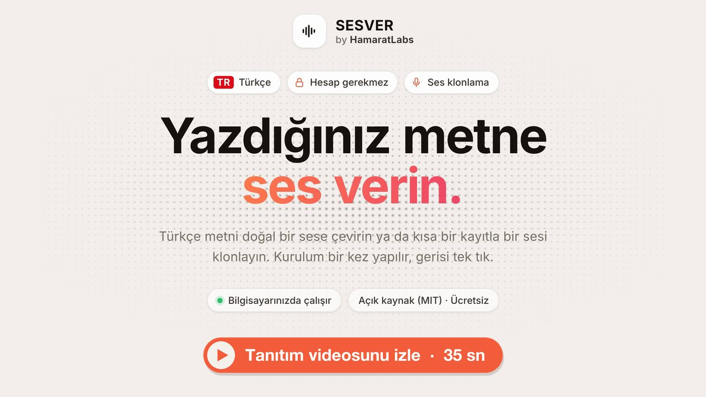
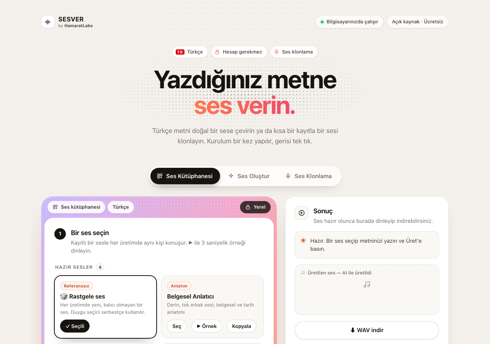

# SesVer

HamaratLabs tarafından geliştirilmiştir.

**Yerel Türkçe ses üretimi + ses klonlama; açık kaynak (MIT) ve tamamen ücretsiz.** Metninizi yazın, **Üret**'e basın, sonucu dinleyip WAV olarak indirin. Hesap, API anahtarı veya ücretli servis gerekmez.

<a href="https://github.com/hamarat52/sesver/releases/download/v1.4.0/SesVer-Tanitim-1.4.0.mp4"></a>

▶️ [**Tanıtım videosunu izleyin**](https://github.com/hamarat52/sesver/releases/download/v1.4.0/SesVer-Tanitim-1.4.0.mp4) (35 sn, sesli, Türkçe altyazılı)

**İçindekiler:** [Windows Kurulum](#-windows-kurulum) · [Mac Kurulum](#-mac-kurulum) · [Yapay Zeka Destekli Kurulum](#-yapay-zeka-destekli-kurulum) · [Özellikler](#özellikler) · [Sorun giderme](#sorun-giderme) · [Code signing policy](#code-signing-policy) · [Privacy policy / Gizlilik](#privacy-policy) · [Lisans](#lisans-atıf-ve-sorumlu-kullanım) · [Teknik Detaylar](#teknik-detaylar-ileri-seviye)

## 🪟 Windows Kurulum

Normal bir Windows programı gibi **İleri** ve **Kur** düğmeleriyle kurulur; Başlat menüsüne ve masaüstüne **SesVer** simgesi eklenir. Yönetici izni gerekmez. En az **20 GB boş alan** ve **internet** gerekir.

1. **İndirin:** [**SesVer-Kurulum-Windows.exe**](https://github.com/hamarat52/sesver/releases/latest/download/SesVer-Kurulum-Windows.exe) (her zaman en son sürüm; tüm sürümler: [Releases](https://github.com/hamarat52/sesver/releases/latest)). GitHub hesabı gerekmez.
2. **Çalıştırın:** İndirilen dosyaya çift tıklayın. **"Windows bilgisayarınızı korudu"** penceresi çıkarsa **Ek bilgi → Yine de çalıştır** deyin (kurulum programı kod imzasız olduğu için bu uyarı çıkar; ayrıntı: [Code signing policy](#code-signing-policy)).
3. **Kurun:** Lisansı kabul edin → **İleri**. Masaüstü simgesi istemiyorsanız ilgili kutunun işaretini kaldırın → **İleri**. **Gizlilik ve güncelleme denetimi** sayfası SesVer'in internete ne zaman bağlandığını özetler; **Açılışta güncellemeleri denetle** kutusu işaretlidir, istemiyorsanız kaldırın (sonra Ayarlar'dan da değiştirebilirsiniz) → **İleri → Kur**.
4. **Bekleyin:** Dosyalar kopyalanınca kurulum penceresinde **"SesVer hazırlanıyor"** sayfası açılır ve Python ile paketleri indirir; ilerleme çubuğu ve geçen süre görünür. **5–30 dakika** sürebilir, yaklaşık **3 GB** iner, internet gerekir. Ayrı bir siyah pencere açılmaz. İsterseniz **Kurulumu durdur** diyebilirsiniz; SesVer'i ilk açtığınızda kaldığı yerden devam eder.
5. **Bitirin:** Son sayfada **"SesVer'i şimdi aç"** işaretli kalsın → **Bitir**. SesVer penceresi açılır.
6. **Hata olursa:** Son sayfa hangi adımda durduğunu yazar; **Günlüğü aç** düğmesi `kurulum_log_paylas.txt` dosyasını açar. İnterneti kontrol edip masaüstündeki **SesVer** simgesine çift tıklayın, kurulum kaldığı yerden devam eder. Sorun sürerse `kurulum_log_paylas.txt` dosyasını **hermes.agent.hamarat@gmail.com** adresine gönderin. Bu kopyada ev klasörü yollarınız (`C:\Users\<adınız>`) gizlenmiştir. Bu kopya oluşturulamadıysa son sayfada düğme çıkmaz; o zaman yalnız durduğu adımı yazın.
7. **Pencere açılmazsa:** Tarayıcınızda (Chrome, Edge) **http://127.0.0.1:7860** adresini açmayı deneyin. Ayrıntı: `%LOCALAPPDATA%\Programs\SesVer\sesver_log.txt`.

### Sonra nasıl açarım?

- **Başlat** menüsüne **SesVer** yazıp Enter'a basın ya da masaüstündeki **SesVer** simgesine çift tıklayın. Kurulum tekrarlanmaz.
- İlk kurulum yarıda kaldıysa aynı simge kaldığı yerden devam eder.
- **Kaldırma:** Ayarlar → Uygulamalar → **SesVer** → Kaldır. Kendi sesleriniz (`voices\seslerim`) ve ürettiğiniz sesler (`outputs`) silinmez. Kaldırırken SesVer, indirdiği Python ortamını ve paketleri (yaklaşık 3 GB) saklamak isteyip istemediğinizi sorar: **Sakla** (varsayılan) seçerseniz aynı klasöre yeniden kurduğunuzda bunlar yeniden inmez; **Sil** seçerseniz yer açılır. Sessiz kaldırmada (`/VERYSILENT`) bunlar silinir; saklamak için `/BILESENLERISAKLA` ekleyin.

### Alternatif (ileri kullanıcı): ZIP ile

**Code → Download ZIP** → ZIP'e sağ tık → **Tümünü Ayıkla** → klasördeki **`WINDOWS_BASLAT.bat`**'a çift tıklayın. Bu yol **kısayol/simge oluşturmaz**; SesVer'i her seferinde bu klasördeki `WINDOWS_BASLAT.bat` ile açarsınız.

## 🍎 Mac Kurulum

SesVer'in Mac sürümü Apple tarafından onaylanmış (notarize edilmiş) bir uygulamadır; normal bir Mac uygulaması gibi kurulur. **Apple Silicon (M1 ve sonrası) ve macOS 14 (Sonoma) ya da daha yenisi gerekir.** Intel işlemcili Mac'lerde kurulum başlamaz. İlk açılışta gerekli her şey (Python dahil) otomatik indirilir; en az **20 GB boş alan** ve **internet** gerekir.

1. **İndirin:** [**SesVer-macOS.dmg**](https://github.com/hamarat52/sesver/releases/latest/download/SesVer-macOS.dmg) (yaklaşık 5,3 MB, her zaman en son sürüm; tüm sürümler: [Releases](https://github.com/hamarat52/sesver/releases/latest)). GitHub hesabı gerekmez.
2. **İsterseniz doğrulayın:** Terminal'i açıp `shasum -a 256 ~/Downloads/SesVer-macOS.dmg` yazın. Çıkan değer, sürüm sayfasındaki (Releases) SHA256 değeriyle aynı olmalı. Farklıysa dosyayı açmayın, yeniden indirin.
3. **Kurun:** İndirilen `SesVer-macOS.dmg` dosyasına çift tıklayın. Açılan pencerede **SesVer** simgesini **Applications** (Uygulamalar) klasörüne sürükleyin. Sonra pencereyi kapatıp masaüstündeki SesVer diskini çıkarın.
4. **Açın:** **Uygulamalar** klasöründeki **SesVer**'e çift tıklayın. İnternetten indirildiği için macOS bir kez "açmak istediğinizden emin misiniz?" diye sorar, **Aç** deyin.
5. **Bekleyin:** İlk açılışta SesVer Python'u ve paketleri indirir ("SesVer ilk kez kuruluyor" penceresi çıkar). Bu yalnız bir kere olur. Kurulum bitince **SesVer penceresi kendiliğinden açılır**. Pencere açılmazsa Safari'de **http://127.0.0.1:7860** adresini açın.

**Ne kadar sürer, ne kadar yer kaplar?** (Ölçüm 28 Ekim 2026, Apple Silicon Mac, hızlı ev bağlantısı)

| Aşama | İndirme | Diskte | Ölçülen süre |
|---|---|---|---|
| Kurulum: Python + paketler (ilk açılışta, otomatik) | ~0,4 GB | ~1,7 GB | 82 sn kurulum + 36 sn arayüzün açılması |
| Ses modeli (ilk **Üret**'te, bir kere) | ~5,0 GB | ~4,6 GB | 102 sn |
| Yazıya dökme modeli (yalnız **Otomatik yazıya dök** ilk kullanılınca) | ~0,5 GB | ~0,5 GB | ölçülmedi |

Toplam indirme yaklaşık **5,4 GB**. Bu yüzden süreyi en çok internet hızınız belirler. Kabaca hesap: 100 Mbit/sn'de ~8 dk, 50 Mbit/sn'de ~15 dk, 25 Mbit/sn'de ~30 dk (bu süreler hesaplanmıştır, ölçülmemiştir). Mac'te ölçülen disk kullanımı ~7 GB'tır. **20 GB** boş alan önerisi; ürettiğiniz sesler, güncellemeler ve kurulum sırasındaki geçici dosyalar için güvenlik payıdır.

İlk açılışta inen her şey sabit sürümle ve bilinen bir SHA-256 özetiyle iner (Python ve tüm paketler; ayrıntı: [Başlatıcılar ne yapar?](#başlatıcılar-ne-yapar)). Bir dosyanın özeti tutmazsa kurulum durur ve SesVer bunu bir pencerede söyler.

### Sonra nasıl açarım? (Mac)

- **Uygulamalar** klasöründeki ya da Launchpad'deki **SesVer**'e tıklayın. Kurulum tekrarlanmaz. İsterseniz Dock'a sabitleyin (açıkken Dock'taki simgeye sağ tık → **Seçenekler → Dock'ta Tut**).
- Kendi sesleriniz, ürettiğiniz sesler ve kurulum dosyaları `~/Library/Application Support/SesVer` klasöründe durur. Kurulum günlüğü: aynı klasördeki `sesver_baslatici_log.txt`.
- Yeni sürüm çıkınca yeni DMG'yi indirip aynı şekilde **Uygulamalar**'a sürükleyin (eskisinin yerine). Sesleriniz korunur; yalnız değişen paketler iner.
- Kapatmak için SesVer penceresini kapatın.

### Kaynaktan çalıştırma (ileri kullanıcı)

GitHub'daki **Code → Download ZIP** ile indirilen klasör de çalışır: klasördeki **`MACOS_BASLAT.command`** dosyasına çift tıklayın (bu yol notarize edilmemiştir; macOS ilk seferde **Sistem Ayarları → Gizlilik ve Güvenlik → Yine de Aç** onayı ister). İlk açılıştan sonra aynı klasördeki `SesVer.app` de kullanılabilir. Klasörü kurulumdan sonra taşımayın. Komut satırıyla kurulum için: [Elle kurulum](#elle-kurulum).

## 🤖 Yapay Zeka Destekli Kurulum

Kurulumu yapay zeka asistanınızla adım adım yapabilirsiniz:

1. [AI_KURULUM.md](https://github.com/hamarat52/sesver/blob/main/AI_KURULUM.md) dosyasını GitHub'da açın (repoyu indirmenize gerek yok).
2. Dosyanın sağ üst köşesindeki **kopyala simgesine** (iki üst üste kare) basın; tüm metin kopyalanır.
3. Kendi yapay zeka sohbetinize (ChatGPT, Claude, Gemini, Copilot…) yapıştırın ve Windows mu Mac mi kullandığınızı söyleyin.

Asistan sizi adım adım yönlendirir ve hata mesajlarını çözmenize yardım eder.

## ✅ Kurulum başarılı mı?

Bu sayfayı görüyorsanız kurulum başarılı:



- İlk **Üret**'te ses modeli (yaklaşık 5 GB) bir kere indirilir; ilk seferde uzun sürebilir, sonrakiler daha hızlıdır.
- Sonraki kullanımlarda **Windows**'ta Başlat menüsündeki ya da masaüstündeki **SesVer** simgesine, **Mac**'te **Uygulamalar** klasöründeki **SesVer**'e tıklayın. Pencere kendiliğinden açılır ve kurulum tekrarlanmaz.
- Kapatmak için SesVer penceresini kapatmanız yeterli (kaynaktan Terminal ile açtıysanız Terminal'de **Ctrl+C** da olur).
- Sorun mu çıktı? [Sorun giderme](#sorun-giderme) bölümüne bakın veya [yapay zeka destekli kurulumu](#-yapay-zeka-destekli-kurulum) kullanın.

## Özellikler

SesVer, OpenBMB'nin [VoxCPM2](https://huggingface.co/openbmb/VoxCPM2) ses modelini kullanır. Arayüz ilk açılışta bilgisayarınızın dilinde açılır (desteklenmiyorsa İngilizce); sağ üstteki dil seçicisinden (seçili dilin adını gösterir, ör. **Türkçe**) 10 dile daha geçilebilir (ayrıntı: [Diller](#diller)). Her şey kendi bilgisayarınızda çalışır.

- **📚 Ses Kütüphanesi (açılış sekmesi):** Bir ses kartı seçip metninizi o sesle okutun. **Hazır sesler** (Yaşlı Masalcı, Belgesel Anlatıcı, Heyecanlı Sunucu) tarifle tasarlanmış sentetik seslerdir, gerçek kişi değildir; **Kopyala** ile kendi düzenlenebilir kopyanız **Seslerim**'e eklenir. ▶ **Örnek** 3 saniyelik örneği çalar. Kayıtlı bir sesle her üretimde aynı kişi konuşur. Duygu seçebilirsiniz, ancak bu sesin benzerliğini biraz azaltır. **Kalite:** Hızlı / Dengeli / En İyi.
- **🎲 Rastgele ses:** Referans olmadan üretim; duygu serbestçe seçilir, ancak her seferinde aynı konuşmacı garanti edilmez.
- **🎨 Ses Oluştur → Seçimlerle tarif et:** Yaş, cinsiyet, ton, doku, hız gibi seçimlerle yeni bir ses tasarlayın. **Sesleri Dene** 4 aday üretir; beğendiğinize ad verip **Kaydet**'e basın, ses Seslerim'e eklenir.
- **📁 Ses Oluştur → Dosya yükle:** 8–20 saniyelik bir kayıttan (WAV/MP3/M4A) ya da doğrudan **mikrofonla konuşarak** kalıcı bir ses oluşturun. Mikrofonla kayıtta **Kaydet**'e basıp konuşur, **Durdur**'a basarsınız; kayıt sürerken süre 8–20 sn kuralına göre gösterilir, sonra kaydı dinleyip silebilir ve yeniden alabilirsiniz. Mikrofon kaydı dosyayla aynı işlemlerden geçer ve bilgisayarınızda kalır. Konuşulan metin otomatik çıkarılır, düzeltebilirsiniz. **İzin kutucuğu** işaretlenmeden kaydedilemez.
- **🎙️ Klonlama:** Yalnız kendi sesinizi veya açık izin aldığınız bir sesi yükleyin ya da **mikrofonla kaydedin** (referans kutusunun altındaki mikrofon simgesi → **Kaydet** → konuşun → **Durdur**; kayıt sürerken süre 1–30 sn kuralına göre gösterilir, dinleyip silebilir ve yeniden alabilirsiniz, kayıt bilgisayarınızda kalır). Tek kişinin konuştuğu, müziksiz, temiz **3–15 saniyelik WAV** önerilir (kabul edilen: 1–30 sn). Referans sesin metnini de girerseniz klon kalitesi belirgin artar; **🎙️ Otomatik yazıya dök** bunu sizin yerinize yazar (mikrofon kaydıyla da çalışır). Duygu seçmek benzerliği azaltabilir; en sadık klon için "Nötr" bırakın.
- **🎛️ Efektler:** Cızırtı, Lo-fi, Telefon, Telsiz, Oda/yankı, Megafon. Ham ses korunur, efektli kopya ayrı kaydedilir. Ayarlar kayıtlı bir sese ön ayar olarak kaydedilebilir.
- **⚡ Hızlı Mod (isteğe bağlı, yalnız Türkçe):** Ayrı ve çok küçük bir ses motoru ([EMA Lightning](https://huggingface.co/canberkkkkkk/ema-lightning), Apache-2.0) ile saniyeler içinde Türkçe seslendirme. Tek ses vardır; klon, ses tarifi ve duygu yoktur. Sekmedeki **Hızlı Mod'u indir** bir kez ~35 MB indirir (paketler SesVer'in kendi Python ortamına, model `models/ema-lightning/` klasörüne; dosyalar SHA-256 ile doğrulanır, iptal edilebilir). Hız (0,5–2×), isteğe bağlı seed ve isteğe bağlı **SRT altyazı** desteklenir. **Hızlı Mod'u kaldır** model dosyalarını ve iki paketi siler. Not: Ses Kütüphanesi'ndeki "Kalite: Hızlı" ayarı ayrı bir şeydir (VoxCPM2'nin hızlı ayarı).
- **⬇ İndirme:** Sonucu dinleyip **⬇ WAV indir** ile kaydedin. Dosyalar ayrıca `outputs/` klasöründedir.
- **🔒 Yerel ve gizli:** Metniniz ve sesleriniz bulut servisine gönderilmez. Kişisel sesleriniz Git'e girmez.

**İpuçları:** İstek başına en fazla **500 karakter** kabul edilir; ilk denemede kısa bir cümle kullanın. **Üret**'e bastıktan sonra durum mesajını bekleyin, tekrar tekrar basmayın. Telaffuz, ses benzerliği ve kalite değişebilir: uzun metni cümlelere bölün, kısaltmaları okunuşuyla yazın. Bu sürümde gürültü temizleme yoktur; temiz referans kullanın.

## Diller

**Arayüz dili ile ses üretim dili ayrı şeylerdir.**

- **Arayüz dili** (sağ üstteki dil seçicisi; üzerinde seçili dilin adı yazar): menüler, düğmeler, uyarı ve hata iletileri. 11 seçenek: Türkçe (kaynak dil), English, Español, 简体中文, हिन्दी, العربية, Français, Português, Русский, Deutsch, 日本語. İlk açılışta arayüz bilgisayarınızın dilinde açılır (desteklenmiyorsa İngilizce). Seçim `ayarlar.json` dosyasına yazılır ve masaüstü uygulaması bir sonraki açılışta aynı dille başlar. Her dil ayrı bir adrestedir: Türkçe kökte (`http://127.0.0.1:7860/`), diğerleri `/en`, `/es`, `/zh`, `/hi`, `/ar`, `/fr`, `/pt`, `/ru`, `/de`, `/ja`.
- **Ses üretim dili:** VoxCPM2'nin [model kartına](https://huggingface.co/openbmb/VoxCPM2) göre model 30 dilde konuşur (Arapça, Çince, İngilizce, Fransızca, Almanca, Hintçe, Japonca, Portekizce, Rusça, İspanyolca, Türkçe dahil; tam liste model kartında) ve **dil etiketi almaz**: metni hangi dilde yazarsanız o dilde okur. Bu yüzden ayrı bir “ses dili” ayarı yoktur; arayüz dilini değiştirmek sesi değiştirmez, metnin dili değiştirir. Ses Kütüphanesi ve Ses Klonlama'daki metin kutusunun altında bu kısaca yazar: “Hangi dilde yazarsanız o dilde okur.” Bu projede gerçek üretimle doğrulanan dil Türkçedir (bkz. [gerçek üretim testi](#bu-sürümün-gerçek-üretim-testi)); diğer dillerdeki kalite model kartındaki iddiaya dayanır, burada ayrıca ölçülmedi.
- **Otomatik yazıya dökme (Whisper):** Türkçe arayüzde kayıt Türkçe kabul edilir (eski davranış). Diğer arayüz dillerinde Whisper kaydın dilini kendisi algılar.
- **Türkçe kalanlar (bilerek):** Ses tasarımındaki örnek cümleler (süreleri Türkçe metne göre ayarlı), sizin kaydettiğiniz seslerin adları/açıklamaları ve terminal günlükleri çevrilmez. Hazır seslerin adı ve açıklaması çevrilir.
- **Sağdan sola (Arapça):** Pragmatik orta yol seçildi: metinler sağdan sola okunur ve sağa hizalanır, sayfa düzeni (ızgara, kart yerleri, sekmeler) soldan sağa kalır. Metin kutuları yazılan içeriğin yönünü izler (Arapça arayüzde Türkçe metin yine soldan sağa yazılır). Tam ayna düzen, Gradio bileşenlerinin RTL desteği tutarsız olduğu için bu sürümde yapılmadı.
- **Çeviriler:** `locales/<dil>.json` dosyalarındadır; anahtar, Türkçe kaynak metnin kendisidir. Çeviriler yapay zekâ yardımıyla hazırlandı, ana dil konuşanlarca henüz gözden geçirilmedi; düzeltme katkıları memnuniyetle karşılanır. Yeni/değişen metinlerden sonra `python tools/i18n_anahtarlar.py` anahtar listesini (`locales/_kaynak.json`) yeniler, `--check` eksik çeviri ve `{yer_tutucu}`/HTML etiketi uyuşmazlığı arar. Çevirisi olmayan metin Türkçe görünür (arayüz boş kalmaz).

## Güncelleme

SesVer açılışta, arka planda GitHub'daki son sürüm numarasına bakar (tek bir istek, en fazla 3 saniye; hiçbir kişisel veri gönderilmez). Daha yeni bir sürüm varsa sayfanın üstünde **"Yeni sürüm var"** bildirimi çıkar; internet yoksa hiçbir şey göstermez. Kapatmak için: **Ayarlar → Açılışta güncellemeleri denetle**.

İstediğiniz an denetlemek için: **Ayarlar → Güncellemeler → Güncellemeleri şimdi denetle**. Aynı tek istek o an yapılır ve sonuç hemen altında görünür: güncel, yeni sürüm var (release sayfası bağlantısıyla) ya da denetlenemedi (internet yok, zaman aşımı, GitHub istek sınırı). Düğme yalnız siz bastığınızda çalışır; açılış denetimi kapalıyken de kullanılabilir. SesVer güncellemeyi kendisi indirip kurmaz.

- **Windows:** release sayfasındaki yeni `SesVer-Kurulum-Windows.exe`'yi indirip çalıştırın. Ayarlarınız ve sesleriniz korunur. Önceden indirilen Python ortamı ve paketler (~3 GB) yeniden inmez; yalnız yeni sürümde değişen paket varsa o kurulur. Önce kaldırıp sonra kuruyorsanız kaldırırken **Sakla**'yı seçin, aynı klasöre yeniden kurulumda da hiçbir şey yeniden inmez.
- **Mac:** release sayfasından yeni sürümü indirin. DMG kullanıyorsanız yeni `SesVer.app`'i Uygulamalar klasörüne sürükleyip eskisinin yerine koyun (sesleriniz ve ayarlarınız `~/Library/Application Support/SesVer` içinde olduğu için korunur). ZIP/klasör kurulumu kullanıyorsanız yeni klasörü açıp `voices/seslerim` klasörünüzü (kendi sesleriniz) ve `ayarlar.json`'u eski klasörden yenisine kopyalayın. Yeni klasörde ilk açılış, Python ve paket kurulumunu bir kez yeniden yapar.

Bu sürüm numarası kökteki `VERSION` dosyasındadır.

## Sorun giderme

- **"Windows bilgisayarınızı korudu" penceresinde "Yine de çalıştır" yok:** Önce **Ek bilgi** bağlantısına tıklayın. Hâlâ yoksa indirilen `.exe`'ye sağ tık → **Özellikler** → alttaki **Engellemeyi kaldır** kutusunu işaretleyin → **Tamam**, sonra tekrar çift tıklayın.
- **Başlat menüsünde SesVer yok / simge kayboldu:** [Kurulum programını](https://github.com/hamarat52/sesver/releases/latest/download/SesVer-Kurulum-Windows.exe) yeniden çalıştırın; kayıtlı sesleriniz ve çıktılarınız korunur.
- **Siyah pencere açılıp hemen kapanıyor / `was unexpected at this time` yazıyor:** Eski bir sürümü kullanıyorsunuz. En son [kurulum programını](https://github.com/hamarat52/sesver/releases/latest/download/SesVer-Kurulum-Windows.exe) indirip kurun (ZIP kullanıyorsanız ZIP'i yeniden indirip yeni klasördeki `WINDOWS_BASLAT.bat`'ı çalıştırın).
- **`Python hazirlanamadi` / `Python bulunamadı`:** Normalde Python otomatik iner; yalnız indirme başarısız olursa (ör. güvenlik duvarı/şirket ağı) başlatıcı eski yönteme döner ve sizden Python 3.10-3.12 kurmanızı ister. Böyle bir mesaj görürseniz [python.org/downloads](https://www.python.org/downloads/) adresinden kurup (Windows'ta "Add python.exe to PATH" işaretli olsun) başlatıcıyı tekrar çalıştırın.
- **PowerShell'de `is not recognized` / `CommandNotFoundException`:** Dosya adının başına `.\` ekleyin: `.\WINDOWS_BASLAT.bat`
- **`py` komutu bulunamıyor:** Komutlarda `py -3.11` yerine `python` yazın. (Başlatıcı bunu kendisi dener.)
- **Kurulum yarıda kesildi:** Windows'ta SesVer simgesine, Mac'te Uygulamalar'daki SesVer'e (ZIP'te başlatıcıya) tekrar çift tıklayın; kaldığı yerden devam eder.
- **Mac: "SesVer macOS 14 (Sonoma) ya da daha yenisini gerektirir" / "Apple Silicon gerektirir":** SesVer'in kullandığı PyTorch sürümü daha eski macOS'ta ve Intel Mac'te çalışmaz. macOS'u güncelleyin (Apple menüsü → Sistem Ayarları → Genel → Yazılım Güncelleme).
- **Kurulum "SHA-256 özeti tutmuyor" diye durdu:** İndirilen bir dosya beklenen dosyayla aynı değil (yarım/bozuk indirme ya da değiştirilmiş dosya). Güvenlik için hiçbir şey çalıştırılmadı. Bir süre sonra SesVer'i tekrar açın; kurulum yeniden denenir. Sürerse hermes.agent.hamarat@gmail.com adresine durduğu adımı yazın.
- **Kaynaktan (ZIP) çalıştırırken Mac: "SesVer.app, SesVer proje klasörünün içinde durmalı" uyarısı:** İlk açılışı `SesVer.app` ile yaptınız. Aynı klasördeki **`MACOS_BASLAT.command`**'ı açın ([Kaynaktan çalıştırma](#kaynaktan-çalıştırma-ileri-kullanıcı)); sonra `SesVer.app` düzgün açılır.
- **İlk üretim uzun sürüyor:** Model (yaklaşık 5 GB) ilk seferde indirilir. İlerlemeyi SesVer penceresindeki durum mesajından izleyin; Windows'ta kurulum penceresi bu sırada kapanmış olabilir, bu normaldir. M1'de üretim de zaman alır.
- **Bellek hatası / sistem yavaşladı:** Uygulamayı durdurun, diğer ağır uygulamaları kapatın ve daha kısa metinle yeniden başlatın. 8 GB RAM'li cihazlarda kullanım önerilmez.
- **Referans okunmuyor:** 1–30 saniyelik geçerli bir WAV dosyası deneyin.
- **Mikrofonla kayıt çalışmıyor:** SesVer ilk kayıtta mikrofon izni ister; **İzin Ver**'e basın. Daha önce reddettiyseniz Mac'te **Sistem Ayarları → Gizlilik ve Güvenlik → Mikrofon**'da SesVer'i açın, Windows'ta **Ayarlar → Gizlilik ve güvenlik → Mikrofon**'da masaüstü uygulamalarına izin verin ve SesVer'i yeniden açın. Mac'te SesVer'i kaynaktan Terminal ile (`MACOS_BASLAT.command`) açtıysanız pencere mikrofonu kullanamaz; `SesVer.app` ile açın. Her durumda dosya yükleyerek devam edebilirsiniz.
- **7860 portu kullanımda:** SesVer zaten açık. Daha önce açtığınız SesVer'i kapatın (**Windows**'ta SesVer penceresini kapatmanız yeterli; **Mac**'te de SesVer penceresini kapatın, kaynaktan Terminal ile açtıysanız Terminal'de **Ctrl+C** basın), sonra tekrar başlatın.
- **GitHub'da depo görünmüyor / ZIP inmiyor:** Depo herkese açıktır, giriş gerekmez. Adresin doğru yazıldığından (https://github.com/hamarat52/sesver) ve internet bağlantınızdan emin olun; birkaç dakika sonra tekrar deneyin.
- **Destek için günlük göndermek:** SesVer açılıyorsa **Hata raporu gönder** düğmesini kullanın; rapor gönderilmeden önce size gösterilir. SesVer açılmıyorsa `sesver_log.txt`, Windows'ta ilk kurulum yarıda kaldıysa `kurulum_log_paylas.txt` dosyasını gönderin. Bu dosyalarda ev klasörü yollarınız (`C:\Users\<adınız>`, `/Users/<adınız>`) gizlidir. `kurulum_log.txt` dosyasının kendisini göndermeyin; içinde gizlenmemiş yollar vardır.

Çözemediyseniz [AI_KURULUM.md](AI_KURULUM.md) dosyasını yapay zeka asistanınıza verin ya da [issue açın](https://github.com/hamarat52/sesver/issues). İşletim sistemi, Python sürümü, donanım ve kişisel bilgilerden arındırılmış hata mesajı yeterlidir; özel ses kayıtlarınızı paylaşmayın.

## Code signing policy

_Application stage:_ the statement below describes the signing that SesVer has requested from the SignPath Foundation program; it takes effect only after the application is accepted. Until then the installer is not signed (see **Status**).

Free code signing provided by [SignPath.io](https://about.signpath.io), certificate by [SignPath Foundation](https://signpath.org)

- **Status:** SesVer is preparing to apply to the free SignPath Foundation program for open source projects. Until the application is accepted and signing is set up, the Windows installer is **not signed** and Windows SmartScreen shows a warning (see [Windows Kurulum](#-windows-kurulum), step 2). Each release page states whether its files are signed.
- **What will be signed:** only the Windows installer (`SesVer-Kurulum-<version>.exe` and its copy `SesVer-Kurulum-Windows.exe`), built by GitHub Actions ([`.github/workflows/windows-installer.yml`](.github/workflows/windows-installer.yml)) from the source code in this repository. Components that the installer downloads on first run (Python, PyTorch and other packages, model files) come from their own publishers and are not signed by this project.
- **Publisher name:** the certificate is issued to SignPath Foundation, so a signed SesVer installer shows **"SignPath Foundation"** as the publisher, not HamaratLabs.
- **Team roles:** SesVer has a single maintainer, Muhammed Yusuf Hamarat (GitHub [`hamarat52`](https://github.com/hamarat52)), who holds every role.
  - Committers and reviewers: [Muhammed Yusuf Hamarat](https://github.com/hamarat52)
  - Approvers: [Muhammed Yusuf Hamarat](https://github.com/hamarat52)
- **Approval:** every signing request is approved manually by an approver before the file is signed.
- **Privacy policy:** see [Privacy policy](#privacy-policy) below.

**Türkçe:** Windows kurulum programının, SignPath Foundation'ın açık kaynak projelere ücretsiz imza programıyla imzalanması planlanıyor. Başvuru kabul edilip imzalama kurulana kadar dosya **imzasızdır** ve Windows uyarı gösterir. İmzalı dosyada yayıncı olarak HamaratLabs değil, sertifikanın sahibi **"SignPath Foundation"** görünür.

## Privacy policy

SesVer runs on your computer. Your text, your voice recordings and the audio you generate are never uploaded. SesVer has no account, no telemetry and no analytics: Gradio analytics and Hugging Face telemetry are turned off, and the interface server listens only on `127.0.0.1` (no public share link). SesVer contacts the following servers, and only in these situations:

| When | Server | What is sent | How to avoid |
|---|---|---|---|
| Every start (background, at most 3 s), and when you click **Güncellemeleri şimdi denetle** (Settings → Updates; at most 10 s, also when the start-up check is off) | `api.github.com` (GitHub) | One GET request without a body for the latest SesVer release. Headers: `User-Agent: SesVer/<version>`, `Accept`. | Windows installer page "Açılışta güncellemeleri denetle" (silent install: `/GUNCELLEMEDENETIMI=0`), Settings → the same option off, or `SESVER_GUNCELLEME_KONTROLU=0`; the button checks only when you click it |
| First-time setup (Windows installer page, `WINDOWS_BASLAT.bat`, SesVer.app on Mac, `MACOS_BASLAT.command`) | `github.com` (python-build-standalone) | Download of one fixed portable Python build (3.11.18, release 20261026), checked against a SHA-256 value stored in SesVer | Install Python 3.10-3.12 yourself (fallback path) |
| First-time setup, and after an update that changes a lock file in `kilit/` | `pypi.org`, `files.pythonhosted.org` (PyPI) | Package downloads by pip; every package is pinned to an exact version and checked against the SHA-256 values in `kilit/` (`--require-hashes`) | No; SesVer cannot run without these packages |
| First-time setup on Windows with an NVIDIA card; once more at start if the installed PyTorch cannot use the card | `download.pytorch.org` | PyTorch (CUDA build) download by pip, pinned and checked against `kilit/torch-<cuda>.txt` | No NVIDIA card: not contacted |
| First **Generate** (Üret): about 5 GB once, from a fixed model revision; afterwards the cached files are used | `huggingface.co` (model `openbmb/VoxCPM2`, revision `32279eff`) | Model file requests | `HF_HUB_OFFLINE=1` after the model is downloaded |
| First use of **Otomatik yazıya dök** (transcription) | `huggingface.co` (faster-whisper `small` model, revision `536b0662`) | Model file requests | Do not use automatic transcription |
| Only when you click **Hızlı Mod'u indir** | `pypi.org` / `files.pythonhosted.org`, `huggingface.co` (model `canberkkkkkk/ema-lightning`, fixed revision) | Two pinned packages (checked with SHA-256) and about 34 MB of weights, checked with SHA-256 | Do not install Fast Mode |
| Only when you click **Hızlandırmayı etkinleştir** (Ayarlar → Ekran kartı hızlandırma) or its CPU rollback | `download.pytorch.org`, `pypi.org` | Package index listing and PyTorch download | Do not use it |
| Only when you click **Hata raporu gönder** and then **E-posta uygulamasında aç** | none by SesVer | A draft opens in your own e-mail app, addressed to hermes.agent.hamarat@gmail.com. You see the full report first and you send it yourself. It contains only technical data; home folder paths, e-mail addresses and access keys are masked. | Do not send it |

Download CDNs: GitHub release files and Hugging Face model files are served through their providers' download CDNs, so the actual transfer may come from addresses such as `release-assets.githubusercontent.com` (GitHub) or `*.cdn.hf.co` (Hugging Face, region dependent); PyPI files come from `files.pythonhosted.org` and download.pytorch.org is delivered through Amazon CloudFront. These are part of the same services and the same privacy policies apply.

The Windows installer shows a short version of this policy on its "Gizlilik ve güncelleme denetimi" (Privacy and update check) page, with the update check option.

**Microphone:** in **Ses Oluştur → Dosya yükle** (Create voice → Upload file) and in the **Ses Klonlama** (Voice cloning) reference field you can record your own voice with the microphone instead of uploading a file. SesVer opens the microphone only after you press **Record** and you (and your operating system) allow it, and it stops when you press **Stop**. The recording is sent only to SesVer's own interface server on this computer (`127.0.0.1`), is handled exactly like an uploaded file and stays on this computer, in SesVer's own temporary folder (`sesver-gecici` in your system's temporary folder; uploaded files and their prepared copies go there too). SesVer deletes these temporary files automatically: when you save the recording as a voice (the saved voice stays in `voices/seslerim`), when a recording or upload has not been used for 2 hours (checked every 30 minutes), and in any case when SesVer closes; a folder left behind by a crash is removed the next time SesVer starts. It never touches other apps' temporary files, your saved voices or your generated audio in `outputs/`. It is never uploaded and no server above receives it. You can withdraw the permission at any time: on Mac in System Settings → Privacy & Security → Microphone, on Windows in Settings → Privacy & security → Microphone.

Links you click (for example the release page in the "new version" notice) open in your web browser. The servers above see your IP address and the requested file names; their own privacy policies apply: [GitHub](https://docs.github.com/en/site-policy/privacy-policies/github-general-privacy-statement), [PyPI](https://policies.python.org/pypi.org/Privacy-Notice/), [PyTorch / Linux Foundation](https://www.linuxfoundation.org/legal/privacy-policy), [Hugging Face](https://huggingface.co/privacy).

**Türkçe özet:** Metniniz, ses kayıtlarınız ve ürettiğiniz sesler hiçbir yere gönderilmez; hesap, telemetri ve analitik yoktur. SesVer yalnız şu durumlarda internete çıkar: açılışta GitHub'a sürüm denetimi (kurulumdaki seçenekle ya da Ayarlar'dan kapatılır) ve siz **Güncellemeleri şimdi denetle**'ye bastığınızda aynı tek istek, ilk kurulumda ve paket güncellemesinde Python ile paketlerin indirilmesi (GitHub, PyPI; NVIDIA kartlı Windows'ta PyTorch için download.pytorch.org), ilk **Üret**'te ses modelinin Hugging Face'ten sabit bir revizyonla indirilmesi (sonra önbellekten kullanılır), **Otomatik yazıya dök** ilk kullanılınca yazıya dökme modeli, yalnız siz tıklarsanız Hızlı Mod ve GPU hızlandırma indirmeleri. Hata raporu otomatik gönderilmez: siz tıklarsanız e-posta uygulamanızda bir taslak açılır, gönderen sizsiniz. **Mikrofon:** Ses Oluştur → Dosya yükle'de ve Ses Klonlama'nın referans alanında mikrofonla kayıt yalnız siz **Kaydet**'e basıp izin verdiğinizde açılır, **Durdur**'la kapanır. Kayıt yalnız bu bilgisayardaki SesVer sunucusuna (`127.0.0.1`) gider, yüklenen dosyayla aynı şekilde işlenir ve bilgisayarınızda, SesVer'in kendi geçici klasöründe (sistem geçici klasöründe `sesver-gecici`) kalır; hiçbir yere gönderilmez. SesVer bu geçici dosyaları kendisi siler: kaydı ses olarak kaydedince (kaydedilen ses `voices/seslerim`'de kalır), 2 saat kullanılmayan kayıt ve yüklemeleri 30 dakikada bir, her durumda SesVer kapanınca; çökme sonrası kalan klasör bir sonraki açılışta silinir. Başka uygulamaların geçici dosyalarına, kayıtlı seslerinize ve `outputs/`'taki ürettiğiniz seslere dokunmaz. İzni istediğiniz an kaldırabilirsiniz: Mac'te Sistem Ayarları → Gizlilik ve Güvenlik → Mikrofon, Windows'ta Ayarlar → Gizlilik ve güvenlik → Mikrofon.

## Lisans, atıf ve sorumlu kullanım

**SesVer'un kendi kodu (bu arayüz, `app.py`, testler) [MIT License](LICENSE) ile lisanslıdır.** Serbestçe kullanılabilir, değiştirilebilir, ticari ürünlere dahil edilebilir. Tek şart: lisans ve telif bildirimini korumak. Telif sahibi **HamaratLabs**'tir. MIT, OSI tarafından tanımlı bir "open source" lisansıdır.

Bu arayüz sıfırdan yazılmıştır ve yalnız bağımsız `voxcpm` paketini (pip) kullanır; VoiceStudio kodu veya bağımlılığı içermez. Sizin kendi bilgisayarınıza kurduğunuz **[VoxCPM2 modeli](https://huggingface.co/openbmb/VoxCPM2) ve [OpenBMB/VoxCPM](https://github.com/OpenBMB/VoxCPM) kodu ise ayrı bir bağımlılıktır ve kendi Apache-2.0 lisansı altındadır** (ticari kullanıma izin veren farklı bir lisans). SesVer'un lisansı o bağımlılığı kısıtlamaz, sadece bu depodaki arayüz koduna uygulanır. OpenBMB ekibine teşekkürler.

### Sorumluluk reddi

Yazılım **"olduğu gibi", hiçbir garanti vermeden** sunulur. Lisans sahibi/katkıda bulunanlar, yazılımın kullanımından doğan hiçbir zarardan sorumlu değildir ([LICENSE](LICENSE) dosyasındaki garanti reddi maddesi). **Üretilen içerikten ve bu aracın nasıl kullanıldığından tamamen kullanıcı sorumludur.**

**Üretilen içeriği paylaşırken “AI ile üretildi” diye açıkça etiketlemek zorunludur.** Bu, model kartındaki kullanım uyarısıdır; uygulama sese otomatik bir filigran eklemez. Bu lisans başka kişilerin sesini izinsiz kullanma hakkı vermez. Sadece kendi sesinizi veya açık izin aldığınız bir sesi klonlayın; kimliğe bürünme, dolandırıcılık veya yanıltıcı/yasadışı içerik üretmek için kullanmayın. Bu araçla üretilen içerikle yapılan kimliğe bürünme, dolandırıcılık veya herhangi bir yasadışı eylemden tamamen kullanıcı sorumludur; proje sahibi/katkıda bulunanlar sorumlu tutulamaz.

---

## Teknik Detaylar (ileri seviye)

**Çoğu kullanıcının buraya bakmasına gerek yok.** Bu bölüm terminale (komut satırına) aşina kullanıcılar içindir; yukarıdaki Windows/Mac kurulumunu yaptıysanız burayı okumanız gerekmez.

### Model

[OpenBMB VoxCPM2](https://huggingface.co/openbmb/VoxCPM2): 2 milyar parametre, Türkçe dahil 30 dil, 48 kHz ses çıktısı. Arayüz 11 dildedir (bkz. [Diller](#diller)). Gradio arayüzü basittir; **altındaki model küçük/hafif değildir.** GPU zorunlu değildir; donanımınıza göre beklemeniz gerekebilir.

### Gereksinimler

Başlatıcıları kullanıyorsanız Python kurmanız gerekmez (aşağıya bakın). **Elle kurulumda Python 3.10–3.12 kullanın; 3.11 önerilir** ([python.org/downloads](https://www.python.org/downloads/)). Paket kilitleri yalnız bu sürümler için vardır; Python 3.13+ desteklenmez. Mac'te Apple Silicon ve macOS 14 ya da daha yenisi gerekir. En az **20 GB boş disk alanı** ayırın.

```bash
git clone https://github.com/hamarat52/sesver.git
cd sesver
```

Git kullanmıyorsanız GitHub'da **Code → Download ZIP** ile indirin, arşivi açın.

### Başlatıcılar ne yapar?

`MACOS_BASLAT.command` / `WINDOWS_BASLAT.bat` (ve Mac'te SesVer.app) ilk çalıştırmada uygulamaya özel taşınabilir bir Python'u (python-build-standalone, CPython 3.11.18, sürüm 20261026) indirip SesVer'in içinde yazılı sabit SHA-256 özetiyle doğrular, klasördeki `python-embed/` içine açar, paketleri doğrudan oraya kurar ve `app.py`'yi başlatır; sistemdeki Python'a dokunulmaz. Paketler `kilit/` klasöründeki kilit dosyalarından `pip install --require-hashes` ile kurulur: her paket sabit sürümdedir ve özeti tutmayan dosya kurulmaz. Sıra: `kilit/pip.txt` (pip, setuptools) → `kilit/torch-<katman>.txt` (macOS ve NVIDIA'sız Windows: `torch-pypi.txt`; NVIDIA kartlı Windows: `hizlandirma.py`'nin seçtiği `torch-cu126/cu128/cu130.txt`) → `kilit/voxcpm.txt` → `kilit/<platform>-py3XX.txt` (geri kalan her şey). Kilitler `requirements.txt`'den `python tools/kilit_uret.py` (uv) ile üretilir. Eski yöntemle tamamlanmış bir `.venv` kurulumu varsa o kullanılmaya devam eder. Python indirilemezse eski yönteme döner: uygun sistem Python'unu bulur (Windows: `py -3.11` → `py` → `python`; macOS: `python3.11` → `python3.12` → `python3.10` → `python3`) ve `.venv` oluşturur; kilit yalnız Python 3.10-3.12 için olduğundan başka bir sürümde açık bir mesajla durur. İndirilen Python'un özeti tutmazsa sistem Python'una geçilmez, kurulum durur. Kurulum tamamlanınca `python-embed/` (ya da `.venv/`) içine `sesver_kurulum_tamam.txt` yazılır (kilit dosyalarının özeti + voxcpm sürümü); bu dosya yoksa bir sonraki çalıştırmada kurulum kaldığı yerden devam eder, kilitler değişmişse yalnız değişen paketler kurulur. Hata olursa başarısız adımın adı gösterilir.

Port varsayılan olarak **7860**'tır; `GRADIO_SERVER_PORT` ortam değişkeniyle değiştirilebilir (örn. `GRADIO_SERVER_PORT=7861 ./MACOS_BASLAT.command`). Başlatıcılar `desktop.py`'yi çalıştırır; arayüz kendi penceresinde (pywebview) açılır. Pencere açılamazsa varsayılan tarayıcıda açılır.

### Elle kurulum

#### macOS (Apple Silicon)

```bash
python3.11 -m venv .venv
source .venv/bin/activate
python -m pip install --require-hashes --no-deps -r kilit/pip.txt
python -m pip install --require-hashes --no-deps -r kilit/torch-pypi.txt
python -m pip install --require-hashes --no-deps -r kilit/voxcpm.txt
python -m pip install --require-hashes --only-binary=:all: --no-binary=proxy-tools --no-build-isolation -r kilit/macos-arm64-py311.txt
python app.py
```

Python 3.10 ya da 3.12 kullanıyorsanız son kurulum satırında `py311` yerine `py310` / `py312` yazın. `--no-deps`: `voxcpm` paketi varsayılan kurulumda `funasr`, `matplotlib`, `modelscope`, `datasets`, `spaces`, `argbind` gibi bu arayüzün **hiç kullanmadığı** (kodda hiçbir yerde import edilmeyen, yalnız `voxcpm`'in kendi eğitim/demo betiklerine ait) ağır paketleri de kurar; bunları atlamak kurulumu ~400 MB küçültür. `--no-build-isolation`: kaynak paketi olarak gelen tek paket (`proxy-tools`) hash'li kurulan setuptools ile derlenir. Kilit dosyaları `requirements.txt`'den üretilir (`python tools/kilit_uret.py`); `requirements.txt`'yi doğrudan kurmak sürümleri sabitlemez.

#### Windows (PowerShell)

```powershell
py -3.11 -m venv .venv
.\.venv\Scripts\python.exe -m pip install --require-hashes --no-deps -r kilit\pip.txt
.\.venv\Scripts\python.exe -m pip install --require-hashes --no-deps -r kilit\torch-pypi.txt
.\.venv\Scripts\python.exe -m pip install --require-hashes --no-deps -r kilit\voxcpm.txt
.\.venv\Scripts\python.exe -m pip install --require-hashes --only-binary=:all: --no-binary=proxy-tools --no-build-isolation -r kilit\windows-x64-py311.txt
.\.venv\Scripts\python.exe app.py
```

`py` komutu çalışmazsa (bazı Python / Microsoft Store kurulumlarında `py` başlatıcısı yoktur) ilk satırda `python -m venv .venv` kullanın. NVIDIA ekran kartı için ikinci satırda `kilit\torch-pypi.txt` yerine kartınıza uygun `kilit\torch-cu126.txt`, `kilit\torch-cu128.txt` (RTX 50xx, sürücü 570-579) ya da `kilit\torch-cu130.txt` (sürücü 580+) dosyasını kullanın.

Tarayıcıda **http://127.0.0.1:7860** adresini açın. Terminal açık kalmalı; durdurmak için **Ctrl+C** kullanın. Yeniden başlatırken kurulum komutlarını tekrarlamanız gerekmez, ortamı etkinleştirip `python app.py` çalıştırın.

Arayüz hemen açılır. Model, ilk **Üret** tıklamasında Hugging Face'den indirilip belleğe yüklenir; ilk sefer internet gerekir ve süre bağlantınıza bağlıdır. Sonraki kullanımlarda ağırlıklar önbellekten kullanılır. Model hazırken internet olmadan çalıştırmak için macOS/Linux'ta `HF_HUB_OFFLINE=1 python app.py`; PowerShell'de önce `$env:HF_HUB_OFFLINE="1"` ayarlayın.

**NVIDIA GPU:** Elle kurulumda yukarıdaki `kilit\torch-cuXXX.txt` dosyalarından birini kullanın. CUDA'sız PyTorch kuruluysa NVIDIA GPU otomatik kullanılamaz. Model uygun cihazı CUDA → Apple MPS → CPU sırasıyla seçer. CUDA şart değildir.

### Özelliklerin teknik ayrıntıları

- **Kayıtlı sesle üretim** **Devam kipinde** yapılır: sesin `ref.wav` + `ref.txt` dosyası modele verilir, tarif/duygu eklenmez. Kayıtlı seste bir duygu seçilirse kip **Kontrollü Klon**'a geçer ve “Duygu seçmek sesin benzerliğini biraz azaltır” notu görünür. Kalite seçenekleri Hızlı / Dengeli / En İyi = `inference_timesteps` 6 / 10 / 16.
- **🎲 Rastgele ses** eski düz üretimdir: duygu, metnin başına `(energetic)` gibi parantezli talimat olarak eklenir.
- **Seçimlerle tarif et:** Seçimler kurallı bir birleştiriciyle (LLM yok) İngilizce bir tarife çevrilir; kelimeler `voice_design_map.json` içindedir. **Gelişmiş** alanında tarif görünür ve elle düzenlenebilir; parçaların üstüne gelince Türkçe karşılığı çıkar. Örnek cümle süresi kaydırıcıyla 10–20 sn arasında seçilir (varsayılan 14 sn). **Sesleri Dene** aynı tarif ve cümleyle seed 11/22/33/44 ile 4 aday üretir (sırayla; ilk aday hazır olunca dinlenebilir).
- **Dosya yükle:** Dosya mono 16-bit WAV'a çevrilir, baştaki/sondaki sessizlik kırpılır, kırpılma ve düşük seviye için uyarı verilir; uzunsa aralık seçilir. Metin yerel Whisper ile çıkarılır ve boş bırakılamaz.
- **Mikrofonla kayıt (aynı adım):** Gradio kaydedicisi kaydı pencerede (tarayıcıda) WAV'a çevirip yerel sunucuya yükler; sonrası dosya yüklemeyle aynı işlevden (`upload_analyze_ui`) geçer: aynı dönüştürme, kırpma, uyarılar, 8–20 sn kuralı, aralık seçimi, Whisper ve izin kutucuğu. Son kullanılan kaynak geçerlidir (dosya yüklenince mikrofon kutusu, kayıt bitince dosya kutusu boşalır). İzin reddi, mikrofon yokluğu ve meşgul mikrofon için kısa iletiler gösterilir. Mac'te bunun için `SesVer.app`'in Info.plist'inde `NSMicrophoneUsageDescription`, imzasında `com.apple.security.device.audio-input` vardır (gerekçe: `docs/macos-yayin.md`).
- **Ses Klonlama referansında mikrofon:** referans alanı aynı `gr.Audio` bileşeninde dosya ya da mikrofon kabul eder (`sources=["upload", "microphone"]`, dosya varsayılan). Değer her iki yolda da aynı WAV dosya yoludur: `generate_audio` / `kuyruga_ekle_klon_ui`'deki 1–30 sn denetimi ve **Otomatik yazıya dök** (`auto_transcribe`) değişmeden çalışır. Süre göstergesi ve iletiler Ses Oluştur'daki yardımcıyla (`_mic_status_html("klon")`, `_MIC_JS`) aynıdır; kurallar `_MIC_RULES`'ta (1 sn altı kabul edilmez, 3–15 sn önerilir, 30 sn üstü kabul edilmez).
- **Klonlama:** Referans metni girilirse ("devam kipi") model referansı gerçekten anlayarak devam eder; metin Whisper ile otomatik çıkarılabilir. Boş bırakılırsa eski davranış (yalnız ses rengi kopyalama) geçerlidir. Duygu seçiminin benzerliği azaltması, ses kimliği ile stil arasındaki bilinen bir ödünleşimdir.
- **Efektler** üretimden **sonra** numpy/scipy ile uygulanır (modele yazılmaz); ham ses değişmez, efektli kopya `-fx-….wav` olarak yazılır ve -16 LUFS / ≤ -1 dBTP'ye eşitlenir.
- **Kişisel sesler git'e girmez:** `voices/seslerim/` `.gitignore`'dadır; ayrıca `voice_library.py` gerçek kişi klonu adlarını (`PROTECTED_NAMES`) ya da “yüklendi” kaynağını taşıyan hiçbir sesi `voices/hazir/` altına yazmaz.

### Donanım ve gerçekçi beklenti

**16 GB+ RAM önerilir. M1'de gerçek zamanlı değildir.** RTF, üretim süresinin ses uzunluğuna oranıdır: RTF 8, 10 saniyelik ses için yaklaşık 80 saniye beklemek demektir.

| Donanım / kaynak | Beklenti |
| --- | --- |
| Apple Silicon M1, 16 GB RAM | Yaklaşık 9 GB model belleği; önceki kullanıcı testinde RTF ~7–8, 10 saniye ses ~70–80 saniye. Geliştiricinin M1 iMac 16 GB sisteminde çalıştırılmıştır. |
| 8 GB RAM | Bellek takasına düşebilir; RTF ~40–100 olabilir. Neredeyse kullanılamaz hale gelebilir; önerilmez. |
| NVIDIA RTX 4090 | Model kartında RTF ~0,3 raporlanır; bu depoda ölçülmüş bir sonuç değildir. Uyumlu CUDA kurulumu gerekir. |
| Yalnız CPU | Çalışabilir, fakat çok yavaştır. Süre işlemciye ve belleğe bağlıdır. |
| Model indirmesi | Yaklaşık 5 GB; ilk kullanımda internet gerekir. |
| Toplam disk bütçesi | Ortam, ağırlıklar ve paket önbellekleriyle ~17–19 GB'a çıkabilir; 20 GB+ boş alan ayırın. Ses çıktıları ayrıca yer kaplar. |

Bunlar garanti değil, planlama değerleridir. İlk model yüklemesi, referans işleme, diğer açık uygulamalar ve swap süreyi artırır. Tarayıcı sekmeleri, başka modeller ve ağır uygulamalarla aynı anda çalıştırmamak faydalıdır. İşlem bittikten sonra model, uygulamayı kapatana kadar RAM'de tutulur.

### Bu sürümün gerçek üretim testi

M1 iMac / 16 GB RAM / Python 3.11.1 üzerinde `python app.py` başlatılıp Gradio uç noktasından iki gerçek üretim yapıldı (VoxCPM 2.0.3, Gradio 6.30.0, PyTorch 2.14.1, MPS/float32):

| Test | Çıktı | Uçtan uca bekleme |
| --- | --- | --- |
| Referanssız | 48 kHz, 2,08 saniye | 205,9 saniye; ilk model yüklemesi dahil |
| Referanslı klonlama | 48 kHz, 2,72 saniye | 128,0 saniye; model bellekteyken |

Test metni: “Merhaba, bugün Türkçe ses üretimini deniyoruz.” Her iki WAV sessiz olmayan, sonlu örneklerden oluştu; kırpılma saptanmadı. Yerel Whisper small ile konuşma içeriği geri çözüldü (küçük yazım/bölütleme farklarıyla). Bu, insan dinlemesi veya ses benzerliği puanı değildir. Test sırasında sistemde yoğun swap kullanımı vardı; bu oturumun süreleri yukarıdaki önceki M1 ölçümünden belirgin şekilde kötüdür. **16 GB RAM tek başına hızlı çalışmayı garanti etmez.** Windows/Linux ve NVIDIA performansı bu sürümde ayrıca test edilmedi.

### Yerellik ve gizlilik

Tam liste ve kapatma yolları: [Privacy policy](#privacy-policy).

- Ses üretimi bilgisayarınızda yapılır; metin ve referans ses bulut servisine gönderilmez.
- Mikrofonla kayıt yalnız siz **Kaydet**'e basıp izin verdiğinizde açılır; kayıt yalnız yerel sunucuya (`127.0.0.1`) gider ve bilgisayarınızda kalır.
- Gradio analitiği ve Hugging Face telemetrisi kapalıdır. Sunucu yalnız `127.0.0.1` dinler, herkese açık paylaşım bağlantısı oluşturmaz.
- İlk model/paket indirmeleri için dış sunuculara bağlanılır. İlk kurulumdan sonra yukarıdaki çevrimdışı seçeneği kullanabilirsiniz.
- Açılıştaki güncelleme denetimi yalnız `api.github.com/repos/hamarat52/sesver/releases/latest` adresine gövdesiz bir GET isteğidir (başlıklar: `User-Agent: SesVer/<sürüm>`, `Accept`). Ayarlar'dan ya da `SESVER_GUNCELLEME_KONTROLU=0` ile kapatılabilir.
- Üretilen dosyalar `outputs/` içinde kalır. Mikrofon kayıtları, yüklenen dosyalar ve bunların hazırlık kopyaları SesVer'in kendi geçici klasöründedir (sistem geçici klasöründe `sesver-gecici`); ses olarak kaydedilince, 2 saat kullanılmayınca ve SesVer kapanınca otomatik silinir. Hugging Face model önbelleği genellikle `~/.cache/huggingface/hub` altındadır.
- Kişisel sesler ve model ağırlıkları Git'e dahil edilmez. Depo hiçbir hazır kişisel ses içermez.

### Testler ve katkı

Model indirmeden birim testleri çalıştırmak için:

```bash
python -m unittest discover -s tests -v
```

Testler pahalı model çağrısını taklit eder; gerçek WAV yazımı, referans parametresi, giriş doğrulaması, hata durumu ve arayüz bağlantılarını sınar. Gerçek ses kalitesini birim testleri doğrulamaz.

Hata ve öneriler için [issue açabilirsiniz](https://github.com/hamarat52/sesver/issues). Küçük, odaklı katkılar kabul edilir.
