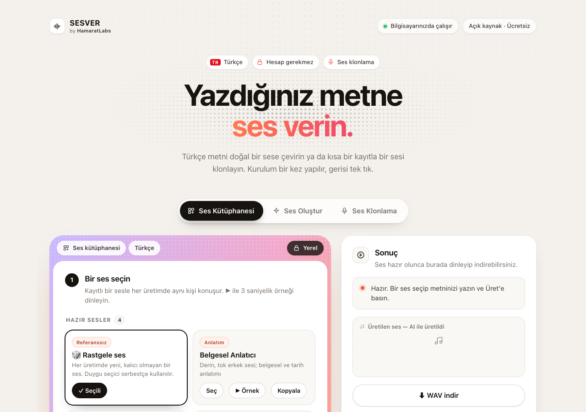

# SesVer

HamaratLabs tarafından geliştirilmiştir.

**Yerel Türkçe ses üretimi + ses klonlama; açık kaynak (MIT) ve tamamen ücretsiz.** Metninizi yazın, **Üret**'e basın, sonucu dinleyip WAV olarak indirin. Hesap, API anahtarı veya ücretli servis gerekmez.

**İçindekiler:** [Windows Kurulum](#-windows-kurulum) · [Mac Kurulum](#-mac-kurulum) · [Yapay Zeka Destekli Kurulum](#-yapay-zeka-destekli-kurulum) · [Özellikler](#özellikler) · [Sorun giderme](#sorun-giderme) · [Lisans](#lisans-atıf-ve-sorumlu-kullanım) · [Teknik Detaylar](#teknik-detaylar-ileri-seviye)

## 🪟 Windows Kurulum

Normal bir Windows programı gibi **İleri → İleri → Kur** ile kurulur; Başlat menüsüne ve masaüstüne **SesVer** simgesi eklenir. Yönetici izni gerekmez. En az **20 GB boş alan** ve **internet** gerekir.

1. **İndirin:** [**SesVer-Kurulum-Windows.exe**](https://github.com/hamarat52/sesver/releases/latest/download/SesVer-Kurulum-Windows.exe) (her zaman en son sürüm; tüm sürümler: [Releases](https://github.com/hamarat52/sesver/releases/latest)). GitHub hesabı gerekmez.
2. **Çalıştırın:** İndirilen dosyaya çift tıklayın. **"Windows bilgisayarınızı korudu"** penceresi çıkarsa **Ek bilgi → Yine de çalıştır** deyin (kurulum programı kod imzasız olduğu için bu uyarı çıkar).
3. **Kurun:** Lisansı kabul edin → **İleri → İleri → Kur**. Masaüstü simgesi istemiyorsanız ilgili kutunun işaretini kaldırın.
4. **Bitirin:** Son sayfada **"İlk kurulumu şimdi başlat"** işaretli kalsın → **Bitir**. Siyah pencere Python'u ve paketleri indirir (ilk sefer uzun sürebilir), sonra SesVer penceresi açılır ve siyah pencere kendiliğinden kapanır.
5. **Pencere açılmazsa:** Tarayıcınızda (Chrome, Edge) **http://127.0.0.1:7860** adresini açmayı deneyin. Ayrıntı: `%LOCALAPPDATA%\Programs\SesVer\sesver_log.txt`.

### Sonra nasıl açarım?

- **Başlat** menüsüne **SesVer** yazıp Enter'a basın ya da masaüstündeki **SesVer** simgesine çift tıklayın. Kurulum tekrarlanmaz.
- İlk kurulum yarıda kaldıysa aynı simge kaldığı yerden devam eder.
- **Kaldırma:** Ayarlar → Uygulamalar → **SesVer** → Kaldır. Kendi sesleriniz (`voices\seslerim`) ve ürettiğiniz sesler (`outputs`) silinmez.

### Alternatif (ileri kullanıcı): ZIP ile

**Code → Download ZIP** → ZIP'e sağ tık → **Tümünü Ayıkla** → klasördeki **`WINDOWS_BASLAT.bat`**'a çift tıklayın. Bu yol **kısayol/simge oluşturmaz**; SesVer'i her seferinde bu klasördeki `WINDOWS_BASLAT.bat` ile açarsınız.

## 🍎 Mac Kurulum

İlk çalıştırmada gerekli her şey (Python dahil) otomatik indirilir, ayrıca bir şey kurmanıza gerek yok. En az **20 GB boş alan** ve **internet** gerekir.

**İlk açılış her zaman `MACOS_BASLAT.command` ile yapılır** (klasördeki `SesVer.app` ile değil). SesVer şu an Apple tarafından imzalanmış/onaylanmış (notarize) değildir; macOS ilk açılışta bir kez onay ister. İnternetten indirilen bir klasörde `SesVer.app`'e doğrudan çift tıklarsanız macOS uygulamayı geçici bir konumdan çalıştırır ve SesVer proje dosyalarını bulamaz. `MACOS_BASLAT.command` bu sorunu yaşamaz ve ilk açılışta klasörün "internetten indirildi" işaretini kaldırır. Bundan sonra `SesVer.app` normal şekilde açılır.

1. **İndirin:** Bu sayfanın üstündeki yeşil **Code** düğmesi → **Download ZIP**. (GitHub hesabı gerekmez.)
2. **Çıkarın:** İndirilen ZIP dosyasına çift tıklayın. `sesver-main` klasörü oluşur. İsterseniz bu klasörü kalıcı bir yere (ör. Belgeler) taşıyın. Taşıyacaksanız **şimdi** taşıyın, kurulumdan sonra değil.
3. **Başlatın:** Klasördeki **`MACOS_BASLAT.command`** dosyasına çift tıklayın.
4. **macOS uyarısını geçin (yalnız ilk sefer):** **"“MACOS_BASLAT.command” açılmadı"** / **"Apple doğrulayamadı…"** penceresi çıkar. **Bitti**'ye basın (Çöp Sepeti'ne Taşı'ya basmayın). Sonra:
   - **Apple (elma) menüsü → Sistem Ayarları → Gizlilik ve Güvenlik**. Aşağı kaydırıp **Güvenlik** bölümüne gelin.
   - **MACOS_BASLAT.command**'ın engellendiğini söyleyen satırın yanındaki **Yine de Aç**'a basın. Bu düğme uyarıdan sonraki yaklaşık 1 saat içinde görünür. Görmüyorsanız 3. adımı tekrarlayın.
   - Mac parolanızı girin (veya Touch ID kullanın). Tekrar soran pencerede **Yine de Aç**'a basın.
   - Not: macOS 15 (Sequoia) ve sonrasında "sağ tık → Aç" artık bu uyarıyı geçmez. Yalnız yukarıdaki yol çalışır.
5. **Bekleyin:** Bir Terminal penceresi açılır ve gerekenleri kendisi kurar. Bu pencereyi **kapatmayın**. Kurulum bitince **SesVer penceresi kendiliğinden açılır**. Pencere açılmazsa Terminal'de yazan adresi (genelde **http://127.0.0.1:7860**) Safari'de açın.

**Ne kadar sürer, ne kadar yer kaplar?** (Ölçüm 28 Ekim 2026, Apple Silicon Mac, hızlı ev bağlantısı)

| Aşama | İndirme | Diskte | Ölçülen süre |
|---|---|---|---|
| Kurulum: Python + paketler (3. adımdan sonra, otomatik) | ~0,4 GB | ~1,7 GB | 82 sn kurulum + 36 sn arayüzün açılması |
| Ses modeli (ilk **Üret**'te, bir kere) | ~5,0 GB | ~4,6 GB | 102 sn |
| Yazıya dökme modeli (yalnız **Otomatik yazıya dök** ilk kullanılınca) | ~0,5 GB | ~0,5 GB | ölçülmedi |

Toplam indirme yaklaşık **5,4 GB**. Bu yüzden süreyi en çok internet hızınız belirler. Kabaca hesap: 100 Mbit/sn'de ~8 dk, 50 Mbit/sn'de ~15 dk, 25 Mbit/sn'de ~30 dk (bu süreler hesaplanmıştır, ölçülmemiştir). Mac'te ölçülen disk kullanımı ~7 GB'tır. **20 GB** boş alan önerisi; ürettiğiniz sesler, güncellemeler ve kurulum sırasındaki geçici dosyalar için güvenlik payıdır.

### Sonra nasıl açarım? (Mac)

- İlk açılış bittikten sonra klasördeki **`SesVer.app`**'e çift tıklayın. Terminal açılmaz ve kurulum tekrarlanmaz. İsterseniz Dock'a sabitleyin (açıkken Dock'taki simgeye sağ tık → **Seçenekler → Dock'ta Tut**). `SesVer.app`'i klasörün dışına **taşımayın**, çünkü proje dosyalarıyla aynı klasörde durmalıdır.
- Klasör Masaüstü, Belgeler veya İndirilenler'deyse macOS ilk seferde **"SesVer, … klasörünüzdeki dosyalara erişmek istiyor"** diye sorar. **İzin Ver** deyin.
- `MACOS_BASLAT.command` her zaman çalışmaya devam eder. Uygulama açılmazsa bunu kullanın, çünkü hata mesajlarını Terminal'de gösterir.
- Kapatmak için SesVer penceresini kapatın. Terminal ile açtıysanız Terminal'de **Ctrl+C** da olur.

## 🤖 Yapay Zeka Destekli Kurulum

Kurulumu yapay zeka asistanınızla adım adım yapabilirsiniz:

1. [AI_KURULUM.md](https://github.com/hamarat52/sesver/blob/main/AI_KURULUM.md) dosyasını GitHub'da açın (repoyu indirmenize gerek yok).
2. Dosyanın sağ üst köşesindeki **kopyala simgesine** (iki üst üste kare) basın; tüm metin kopyalanır.
3. Kendi yapay zeka sohbetinize (ChatGPT, Claude, Gemini, Copilot…) yapıştırın ve Windows mu Mac mi kullandığınızı söyleyin.

Asistan sizi adım adım yönlendirir ve hata mesajlarını çözmenize yardım eder.

## ✅ Kurulum başarılı mı?

Bu sayfayı görüyorsanız kurulum başarılı:



- İlk **Üret**'te ses modeli (yaklaşık 5 GB) bir kere indirilir; ilk seferde uzun sürebilir, sonrakiler daha hızlıdır.
- Sonraki kullanımlarda **Windows**'ta Başlat menüsündeki ya da masaüstündeki **SesVer** simgesine, **Mac**'te klasördeki **`SesVer.app`**'e çift tıklayın. Pencere kendiliğinden açılır ve kurulum tekrarlanmaz.
- Kapatmak için SesVer penceresini kapatmanız yeterli (**Mac**'te Terminal ile açtıysanız Terminal'de **Ctrl+C** da olur).
- Sorun mu çıktı? [Sorun giderme](#sorun-giderme) bölümüne bakın veya [yapay zeka destekli kurulumu](#-yapay-zeka-destekli-kurulum) kullanın.

## Özellikler

SesVer, OpenBMB'nin [VoxCPM2](https://huggingface.co/openbmb/VoxCPM2) ses modelini kullanır. Arayüz ilk açılışta bilgisayarınızın dilinde açılır (desteklenmiyorsa İngilizce); sağ üstteki **🌐 Arayüz dili** seçicisinden 10 dile daha geçilebilir (ayrıntı: [Diller](#diller)). Her şey kendi bilgisayarınızda çalışır.

- **📚 Ses Kütüphanesi (açılış sekmesi):** Bir ses kartı seçip metninizi o sesle okutun. **Hazır sesler** (Yaşlı Masalcı, Belgesel Anlatıcı, Heyecanlı Sunucu) tarifle tasarlanmış sentetik seslerdir, gerçek kişi değildir; **Kopyala** ile kendi düzenlenebilir kopyanız **Seslerim**'e eklenir. ▶ **Örnek** 3 saniyelik örneği çalar. Kayıtlı bir sesle her üretimde aynı kişi konuşur. Duygu seçebilirsiniz, ancak bu sesin benzerliğini biraz azaltır. **Kalite:** Hızlı / Dengeli / En İyi.
- **🎲 Rastgele ses:** Referans olmadan üretim; duygu serbestçe seçilir, ancak her seferinde aynı konuşmacı garanti edilmez.
- **🎨 Ses Oluştur → Seçimlerle tarif et:** Yaş, cinsiyet, ton, doku, hız gibi seçimlerle yeni bir ses tasarlayın. **Sesleri Dene** 4 aday üretir; beğendiğinize ad verip **Kaydet**'e basın, ses Seslerim'e eklenir.
- **📁 Ses Oluştur → Dosya yükle:** 8–20 saniyelik bir kayıttan (WAV/MP3/M4A) kalıcı bir ses oluşturun. Konuşulan metin otomatik çıkarılır, düzeltebilirsiniz. **İzin kutucuğu** işaretlenmeden kaydedilemez.
- **🎙️ Klonlama:** Yalnız kendi sesinizi veya açık izin aldığınız bir sesi yükleyin. Tek kişinin konuştuğu, müziksiz, temiz **3–15 saniyelik WAV** önerilir (kabul edilen: 1–30 sn). Referans sesin metnini de girerseniz klon kalitesi belirgin artar; **🎙️ Otomatik yazıya dök** bunu sizin yerinize yazar. Duygu seçmek benzerliği azaltabilir; en sadık klon için "Nötr" bırakın.
- **🎛️ Efektler:** Cızırtı, Lo-fi, Telefon, Telsiz, Oda/yankı, Megafon. Ham ses korunur, efektli kopya ayrı kaydedilir. Ayarlar kayıtlı bir sese ön ayar olarak kaydedilebilir.
- **⚡ Hızlı Mod (isteğe bağlı, yalnız Türkçe):** Ayrı ve çok küçük bir ses motoru ([EMA Lightning](https://huggingface.co/canberkkkkkk/ema-lightning), Apache-2.0) ile saniyeler içinde Türkçe seslendirme. Tek ses vardır; klon, ses tarifi ve duygu yoktur. Sekmedeki **Hızlı Mod'u indir** bir kez ~35 MB indirir (paketler SesVer'in kendi Python ortamına, model `models/ema-lightning/` klasörüne; dosyalar SHA-256 ile doğrulanır, iptal edilebilir). Hız (0,5–2×), isteğe bağlı seed ve isteğe bağlı **SRT altyazı** desteklenir. **Hızlı Mod'u kaldır** model dosyalarını ve iki paketi siler. Not: Ses Kütüphanesi'ndeki "Kalite: Hızlı" ayarı ayrı bir şeydir (VoxCPM2'nin hızlı ayarı).
- **⬇ İndirme:** Sonucu dinleyip **⬇ WAV indir** ile kaydedin. Dosyalar ayrıca `outputs/` klasöründedir.
- **🔒 Yerel ve gizli:** Metniniz ve sesleriniz bulut servisine gönderilmez. Kişisel sesleriniz Git'e girmez.

**İpuçları:** İstek başına en fazla **500 karakter** kabul edilir; ilk denemede kısa bir cümle kullanın. **Üret**'e bastıktan sonra durum mesajını bekleyin, tekrar tekrar basmayın. Telaffuz, ses benzerliği ve kalite değişebilir: uzun metni cümlelere bölün, kısaltmaları okunuşuyla yazın. Bu sürümde gürültü temizleme yoktur; temiz referans kullanın.

## Diller

**Arayüz dili ile ses üretim dili ayrı şeylerdir.**

- **🌐 Arayüz dili** (sağ üst seçici): menüler, düğmeler, uyarı ve hata iletileri. 11 seçenek: Türkçe (kaynak dil), English, Español, 简体中文, हिन्दी, العربية, Français, Português, Русский, Deutsch, 日本語. İlk açılışta arayüz bilgisayarınızın dilinde açılır (desteklenmiyorsa İngilizce). Seçim `ayarlar.json` dosyasına yazılır ve masaüstü uygulaması bir sonraki açılışta aynı dille başlar. Her dil ayrı bir adrestedir: Türkçe kökte (`http://127.0.0.1:7860/`), diğerleri `/en`, `/es`, `/zh`, `/hi`, `/ar`, `/fr`, `/pt`, `/ru`, `/de`, `/ja`.
- **Ses üretim dili:** VoxCPM2'nin [model kartına](https://huggingface.co/openbmb/VoxCPM2) göre model 30 dilde konuşur (Arapça, Çince, İngilizce, Fransızca, Almanca, Hintçe, Japonca, Portekizce, Rusça, İspanyolca, Türkçe dahil; tam liste model kartında) ve **dil etiketi almaz**: metni hangi dilde yazarsanız o dilde okur. Bu yüzden ayrı bir “ses dili” ayarı yoktur; arayüz dilini değiştirmek sesi değiştirmez, metnin dili değiştirir. Bu projede gerçek üretimle doğrulanan dil Türkçedir (bkz. [gerçek üretim testi](#bu-sürümün-gerçek-üretim-testi)); diğer dillerdeki kalite model kartındaki iddiaya dayanır, burada ayrıca ölçülmedi.
- **Otomatik yazıya dökme (Whisper):** Türkçe arayüzde kayıt Türkçe kabul edilir (eski davranış). Diğer arayüz dillerinde Whisper kaydın dilini kendisi algılar.
- **Türkçe kalanlar (bilerek):** Ses tasarımındaki örnek cümleler (süreleri Türkçe metne göre ayarlı), sizin kaydettiğiniz seslerin adları/açıklamaları ve terminal günlükleri çevrilmez. Hazır seslerin adı ve açıklaması çevrilir.
- **Sağdan sola (Arapça):** Pragmatik orta yol seçildi: metinler sağdan sola okunur ve sağa hizalanır, sayfa düzeni (ızgara, kart yerleri, sekmeler) soldan sağa kalır. Metin kutuları yazılan içeriğin yönünü izler (Arapça arayüzde Türkçe metin yine soldan sağa yazılır). Tam ayna düzen, Gradio bileşenlerinin RTL desteği tutarsız olduğu için bu sürümde yapılmadı.
- **Çeviriler:** `locales/<dil>.json` dosyalarındadır; anahtar, Türkçe kaynak metnin kendisidir. Çeviriler yapay zekâ yardımıyla hazırlandı, ana dil konuşanlarca henüz gözden geçirilmedi; düzeltme katkıları memnuniyetle karşılanır. Yeni/değişen metinlerden sonra `python tools/i18n_anahtarlar.py` anahtar listesini (`locales/_kaynak.json`) yeniler, `--check` eksik çeviri ve `{yer_tutucu}`/HTML etiketi uyuşmazlığı arar. Çevirisi olmayan metin Türkçe görünür (arayüz boş kalmaz).

## Güncelleme

SesVer açılışta, arka planda GitHub'daki son sürüm numarasına bakar (tek bir istek, en fazla 3 saniye; hiçbir kişisel veri gönderilmez). Daha yeni bir sürüm varsa sayfanın üstünde **"Yeni sürüm var"** bildirimi çıkar; internet yoksa hiçbir şey göstermez. Kapatmak için: **Ayarlar → Açılışta güncellemeleri denetle**.

- **Windows:** release sayfasındaki yeni `SesVer-Kurulum-Windows.exe`'yi indirip çalıştırın. Ayarlarınız ve sesleriniz korunur.
- **Mac:** release sayfasından yeni sürümü indirin. DMG kullanıyorsanız yeni `SesVer.app`'i Uygulamalar klasörüne sürükleyip eskisinin yerine koyun (sesleriniz ve ayarlarınız `~/Library/Application Support/SesVer` içinde olduğu için korunur). ZIP/klasör kurulumu kullanıyorsanız yeni klasörü açıp `voices/seslerim` klasörünüzü (kendi sesleriniz) ve `ayarlar.json`'u eski klasörden yenisine kopyalayın. Yeni klasörde ilk açılış, Python ve paket kurulumunu bir kez yeniden yapar.

Bu sürüm numarası kökteki `VERSION` dosyasındadır.

## Sorun giderme

- **"Windows bilgisayarınızı korudu" penceresinde "Yine de çalıştır" yok:** Önce **Ek bilgi** bağlantısına tıklayın. Hâlâ yoksa indirilen `.exe`'ye sağ tık → **Özellikler** → alttaki **Engellemeyi kaldır** kutusunu işaretleyin → **Tamam**, sonra tekrar çift tıklayın.
- **Başlat menüsünde SesVer yok / simge kayboldu:** [Kurulum programını](https://github.com/hamarat52/sesver/releases/latest/download/SesVer-Kurulum-Windows.exe) yeniden çalıştırın; kayıtlı sesleriniz ve çıktılarınız korunur.
- **Siyah pencere açılıp hemen kapanıyor / `was unexpected at this time` yazıyor:** Eski bir sürümü kullanıyorsunuz. En son [kurulum programını](https://github.com/hamarat52/sesver/releases/latest/download/SesVer-Kurulum-Windows.exe) indirip kurun (ZIP kullanıyorsanız ZIP'i yeniden indirip yeni klasördeki `WINDOWS_BASLAT.bat`'ı çalıştırın).
- **`Python hazirlanamadi` / `Python bulunamadı`:** Normalde Python otomatik iner; yalnız indirme başarısız olursa (ör. güvenlik duvarı/şirket ağı) başlatıcı eski yönteme döner ve sizden Python 3.10-3.12 kurmanızı ister. Böyle bir mesaj görürseniz [python.org/downloads](https://www.python.org/downloads/) adresinden kurup (Windows'ta "Add python.exe to PATH" işaretli olsun) başlatıcıyı tekrar çalıştırın.
- **PowerShell'de `is not recognized` / `CommandNotFoundException`:** Dosya adının başına `.\` ekleyin: `.\WINDOWS_BASLAT.bat`
- **`py` komutu bulunamıyor:** Komutlarda `py -3.11` yerine `python` yazın. (Başlatıcı bunu kendisi dener.)
- **Kurulum yarıda kesildi:** Windows'ta SesVer simgesine (ZIP'te ve Mac'te başlatıcıya) tekrar çift tıklayın; kaldığı yerden devam eder.
- **Mac: "Apple doğrulayamadı" / "açılmadı" uyarısı:** [Mac Kurulum](#-mac-kurulum) 4. adım: **Bitti** → **Sistem Ayarları → Gizlilik ve Güvenlik → Yine de Aç** → parola. "Sağ tık → Aç" macOS 15 ve sonrasında işe yaramaz.
- **Mac: "SesVer.app, SesVer proje klasörünün içinde durmalı" ya da "macOS SesVer'i geçici bir konumdan açtı" uyarısı:** İlk açılışı `SesVer.app` ile yaptınız. Aynı klasördeki **`MACOS_BASLAT.command`**'ı açın (4. adımdaki onayla). Bu işlem klasörün indirme işaretini kaldırır; sonra `SesVer.app` düzgün açılır.
- **İlk üretim uzun sürüyor:** Model (yaklaşık 5 GB) ilk seferde indirilir. İlerlemeyi SesVer penceresindeki durum mesajından izleyin; Windows'ta kurulum penceresi bu sırada kapanmış olabilir, bu normaldir. M1'de üretim de zaman alır.
- **Bellek hatası / sistem yavaşladı:** Uygulamayı durdurun, diğer ağır uygulamaları kapatın ve daha kısa metinle yeniden başlatın. 8 GB RAM'li cihazlarda kullanım önerilmez.
- **Referans okunmuyor:** 1–30 saniyelik geçerli bir WAV dosyası deneyin.
- **7860 portu kullanımda:** SesVer zaten açık. Daha önce açtığınız SesVer'i kapatın (**Windows**'ta SesVer penceresini kapatmanız yeterli; **Mac**'te Terminal penceresinde **Ctrl+C** basın), sonra tekrar başlatın.
- **GitHub'da depo görünmüyor / ZIP inmiyor:** Depo herkese açıktır, giriş gerekmez. Adresin doğru yazıldığından (https://github.com/hamarat52/sesver) ve internet bağlantınızdan emin olun; birkaç dakika sonra tekrar deneyin.

Çözemediyseniz [AI_KURULUM.md](AI_KURULUM.md) dosyasını yapay zeka asistanınıza verin ya da [issue açın](https://github.com/hamarat52/sesver/issues). İşletim sistemi, Python sürümü, donanım ve kişisel bilgilerden arındırılmış hata mesajı yeterlidir; özel ses kayıtlarınızı paylaşmayın.

## Lisans, atıf ve sorumlu kullanım

**SesVer'un kendi kodu (bu arayüz, `app.py`, testler) [MIT License](LICENSE) ile lisanslıdır.** Serbestçe kullanılabilir, değiştirilebilir, ticari ürünlere dahil edilebilir — tek şart lisans ve telif bildirimini korumak. Telif sahibi **HamaratLabs**'tir. MIT, OSI tarafından tanımlı bir "open source" lisansıdır.

Bu arayüz sıfırdan yazılmıştır ve yalnız bağımsız `voxcpm` paketini (pip) kullanır; VoiceStudio kodu veya bağımlılığı içermez. Sizin kendi bilgisayarınıza kurduğunuz **[VoxCPM2 modeli](https://huggingface.co/openbmb/VoxCPM2) ve [OpenBMB/VoxCPM](https://github.com/OpenBMB/VoxCPM) kodu ise ayrı bir bağımlılıktır ve kendi Apache-2.0 lisansı altındadır** (ticari kullanıma izin veren farklı bir lisans) — SesVer'un lisansı o bağımlılığı kısıtlamaz, sadece bu depodaki arayüz koduna uygulanır. OpenBMB ekibine teşekkürler.

### Sorumluluk reddi

Yazılım **"olduğu gibi", hiçbir garanti vermeden** sunulur. Lisans sahibi/katkıda bulunanlar, yazılımın kullanımından doğan hiçbir zarardan sorumlu değildir ([LICENSE](LICENSE) dosyasındaki garanti reddi maddesi). **Üretilen içerikten ve bu aracın nasıl kullanıldığından tamamen kullanıcı sorumludur.**

**Üretilen içeriği paylaşırken “AI ile üretildi” diye açıkça etiketlemek zorunludur.** Bu, model kartındaki kullanım uyarısıdır; uygulama sese otomatik bir filigran eklemez. Bu lisans başka kişilerin sesini izinsiz kullanma hakkı vermez. Sadece kendi sesinizi veya açık izin aldığınız bir sesi klonlayın; kimliğe bürünme, dolandırıcılık veya yanıltıcı/yasadışı içerik üretmek için kullanmayın. Bu araçla üretilen içerikle yapılan kimliğe bürünme, dolandırıcılık veya herhangi bir yasadışı eylemden tamamen kullanıcı sorumludur; proje sahibi/katkıda bulunanlar sorumlu tutulamaz.

---

## Teknik Detaylar (ileri seviye)

**Çoğu kullanıcının buraya bakmasına gerek yok.** Bu bölüm terminale (komut satırına) aşina kullanıcılar içindir; yukarıdaki Windows/Mac kurulumunu yaptıysanız burayı okumanız gerekmez.

### Model

[OpenBMB VoxCPM2](https://huggingface.co/openbmb/VoxCPM2): 2 milyar parametre, Türkçe dahil 30 dil, 48 kHz ses çıktısı. Arayüz 11 dildedir (bkz. [Diller](#diller)). Gradio arayüzü basittir; **altındaki model küçük/hafif değildir.** GPU zorunlu değildir; donanımınıza göre beklemeniz gerekebilir.

### Gereksinimler

Başlatıcıları kullanıyorsanız Python kurmanız gerekmez (aşağıya bakın). **Elle kurulumda Python 3.10–3.12 kullanın; 3.11 önerilir** ([python.org/downloads](https://www.python.org/downloads/)). Python 3.13+ bu kurulum için önerilmez. En az **20 GB boş disk alanı** ayırın.

```bash
git clone https://github.com/hamarat52/sesver.git
cd sesver
```

Git kullanmıyorsanız GitHub'da **Code → Download ZIP** ile indirin, arşivi açın.

### Başlatıcılar ne yapar?

`MACOS_BASLAT.command` / `WINDOWS_BASLAT.bat` ilk çalıştırmada uygulamaya özel taşınabilir bir Python'u (python-build-standalone, CPython 3.11) SHA-256 doğrulamasıyla indirip klasördeki `python-embed/` içine açar, paketleri doğrudan oraya kurar ve `app.py`'yi başlatır; sistemdeki Python'a dokunulmaz. Eski yöntemle tamamlanmış bir `.venv` kurulumu varsa o kullanılmaya devam eder. İndirme başarısız olursa eski yönteme döner: uygun sistem Python'unu bulur (Windows: `py -3.11` → `py` → `python`; macOS: `python3.11` → `python3.12` → `python3.10` → `python3`), `.venv` sanal ortamını oluşturur ve aşağıdaki elle kurulum adımlarını çalıştırır. Kurulum tamamlanınca `python-embed/` (ya da `.venv/`) içine `sesver_kurulum_tamam.txt` yazılır; bu dosya yoksa bir sonraki çalıştırmada kurulum kaldığı yerden devam eder. Hata olursa başarısız adımın adı gösterilir.

Port varsayılan olarak **7860**'tır; `GRADIO_SERVER_PORT` ortam değişkeniyle değiştirilebilir (örn. `GRADIO_SERVER_PORT=7861 ./MACOS_BASLAT.command`). Başlatıcılar `desktop.py`'yi çalıştırır; arayüz kendi penceresinde (pywebview) açılır. Pencere açılamazsa varsayılan tarayıcıda açılır.

### Elle kurulum

#### macOS / Linux

```bash
python3.11 -m venv .venv
source .venv/bin/activate
python -m pip install --upgrade pip
pip install --no-deps voxcpm==2.0.3
pip install -r requirements.txt
python app.py
```

`--no-deps`: `voxcpm` paketi varsayılan kurulumda `funasr`, `matplotlib`, `modelscope`, `datasets`, `spaces`, `argbind` gibi bu arayüzün **hiç kullanmadığı** (kodda hiçbir yerde import edilmeyen, yalnız `voxcpm`'in kendi eğitim/demo betiklerine ait) ağır paketleri de kurar — bunları atlamak kurulumu ~400 MB küçültür. `requirements.txt` yalnız gerçekten çalışması için gereken paketleri listeler.

#### Windows (PowerShell)

```powershell
py -3.11 -m venv .venv
.\.venv\Scripts\python.exe -m pip install --upgrade pip
.\.venv\Scripts\python.exe -m pip install --no-deps voxcpm==2.0.3
.\.venv\Scripts\python.exe -m pip install -r requirements.txt
.\.venv\Scripts\python.exe app.py
```

`py` komutu çalışmazsa (bazı Python / Microsoft Store kurulumlarında `py` başlatıcısı yoktur) ilk satırda `python -m venv .venv` kullanın.

Tarayıcıda **http://127.0.0.1:7860** adresini açın. Terminal açık kalmalı; durdurmak için **Ctrl+C** kullanın. Yeniden başlatırken kurulum komutlarını tekrarlamanız gerekmez, ortamı etkinleştirip `python app.py` çalıştırın.

Arayüz hemen açılır. Model, ilk **Üret** tıklamasında Hugging Face'den indirilip belleğe yüklenir; ilk sefer internet gerekir ve süre bağlantınıza bağlıdır. Sonraki kullanımlarda ağırlıklar önbellekten kullanılır. Model hazırken internet olmadan çalıştırmak için macOS/Linux'ta `HF_HUB_OFFLINE=1 python app.py`; PowerShell'de önce `$env:HF_HUB_OFFLINE="1"` ayarlayın.

**NVIDIA GPU:** PyTorch'un CUDA destekli kurulumunu [resmî kurulum seçicisinden](https://pytorch.org/get-started/locally/) işletim sisteminize göre yapın. CUDA'sız PyTorch kuruluysa NVIDIA GPU otomatik kullanılamaz. Model uygun cihazı CUDA → Apple MPS → CPU sırasıyla seçer. CUDA şart değildir.

### Özelliklerin teknik ayrıntıları

- **Kayıtlı sesle üretim** **Devam kipinde** yapılır: sesin `ref.wav` + `ref.txt` dosyası modele verilir, tarif/duygu eklenmez. Kayıtlı seste bir duygu seçilirse kip **Kontrollü Klon**'a geçer ve “Duygu seçmek sesin benzerliğini biraz azaltır” notu görünür. Kalite seçenekleri Hızlı / Dengeli / En İyi = `inference_timesteps` 6 / 10 / 16.
- **🎲 Rastgele ses** eski düz üretimdir: duygu, metnin başına `(energetic)` gibi parantezli talimat olarak eklenir.
- **Seçimlerle tarif et:** Seçimler kurallı bir birleştiriciyle (LLM yok) İngilizce bir tarife çevrilir; kelimeler `voice_design_map.json` içindedir. **Gelişmiş** alanında tarif görünür ve elle düzenlenebilir; parçaların üstüne gelince Türkçe karşılığı çıkar. Örnek cümle süresi kaydırıcıyla 10–20 sn arasında seçilir (varsayılan 14 sn). **Sesleri Dene** aynı tarif ve cümleyle seed 11/22/33/44 ile 4 aday üretir (sırayla; ilk aday hazır olunca dinlenebilir).
- **Dosya yükle:** Dosya mono 16-bit WAV'a çevrilir, baştaki/sondaki sessizlik kırpılır, kırpılma ve düşük seviye için uyarı verilir; uzunsa aralık seçilir. Metin yerel Whisper ile çıkarılır ve boş bırakılamaz.
- **Klonlama:** Referans metni girilirse ("devam kipi") model referansı gerçekten anlayarak devam eder; metin Whisper ile otomatik çıkarılabilir. Boş bırakılırsa eski davranış (yalnız ses rengi kopyalama) geçerlidir. Duygu seçiminin benzerliği azaltması, ses kimliği ile stil arasındaki bilinen bir ödünleşimdir.
- **Efektler** üretimden **sonra** numpy/scipy ile uygulanır (modele yazılmaz); ham ses değişmez, efektli kopya `-fx-….wav` olarak yazılır ve -16 LUFS / ≤ -1 dBTP'ye eşitlenir.
- **Kişisel sesler git'e girmez:** `voices/seslerim/` `.gitignore`'dadır; ayrıca `voice_library.py` gerçek kişi klonu adlarını (`PROTECTED_NAMES`) ya da “yüklendi” kaynağını taşıyan hiçbir sesi `voices/hazir/` altına yazmaz.

### Donanım ve gerçekçi beklenti

**16 GB+ RAM önerilir. M1'de gerçek zamanlı değildir.** RTF, üretim süresinin ses uzunluğuna oranıdır: RTF 8, 10 saniyelik ses için yaklaşık 80 saniye beklemek demektir.

| Donanım / kaynak | Beklenti |
| --- | --- |
| Apple Silicon M1, 16 GB RAM | Yaklaşık 9 GB model belleği; önceki kullanıcı testinde RTF ~7–8, 10 saniye ses ~70–80 saniye. Geliştiricinin M1 iMac 16 GB sisteminde çalıştırılmıştır. |
| 8 GB RAM | Bellek takasına düşebilir; RTF ~40–100 olabilir. Neredeyse kullanılamaz hale gelebilir; önerilmez. |
| NVIDIA RTX 4090 | Model kartında RTF ~0,3 raporlanır; bu depoda ölçülmüş bir sonuç değildir. Uyumlu CUDA kurulumu gerekir. |
| Yalnız CPU | Çalışabilir, fakat çok yavaştır. Süre işlemciye ve belleğe bağlıdır. |
| Model indirmesi | Yaklaşık 5 GB; ilk kullanımda internet gerekir. |
| Toplam disk bütçesi | Ortam, ağırlıklar ve paket önbellekleriyle ~17–19 GB'a çıkabilir; 20 GB+ boş alan ayırın. Ses çıktıları ayrıca yer kaplar. |

Bunlar garanti değil, planlama değerleridir. İlk model yüklemesi, referans işleme, diğer açık uygulamalar ve swap süreyi artırır. Tarayıcı sekmeleri, başka modeller ve ağır uygulamalarla aynı anda çalıştırmamak faydalıdır. İşlem bittikten sonra model, uygulamayı kapatana kadar RAM'de tutulur.

### Bu sürümün gerçek üretim testi

M1 iMac / 16 GB RAM / Python 3.11.1 üzerinde `python app.py` başlatılıp Gradio uç noktasından iki gerçek üretim yapıldı (VoxCPM 2.0.3, Gradio 6.30.0, PyTorch 2.14.1, MPS/float32):

| Test | Çıktı | Uçtan uca bekleme |
| --- | --- | --- |
| Referanssız | 48 kHz, 2,08 saniye | 205,9 saniye; ilk model yüklemesi dahil |
| Referanslı klonlama | 48 kHz, 2,72 saniye | 128,0 saniye; model bellekteyken |

Test metni: “Merhaba, bugün Türkçe ses üretimini deniyoruz.” Her iki WAV sessiz olmayan, sonlu örneklerden oluştu; kırpılma saptanmadı. Yerel Whisper small ile konuşma içeriği geri çözüldü (küçük yazım/bölütleme farklarıyla). Bu, insan dinlemesi veya ses benzerliği puanı değildir. Test sırasında sistemde yoğun swap kullanımı vardı; bu oturumun süreleri yukarıdaki önceki M1 ölçümünden belirgin şekilde kötüdür. **16 GB RAM tek başına hızlı çalışmayı garanti etmez.** Windows/Linux ve NVIDIA performansı bu sürümde ayrıca test edilmedi.

### Yerellik ve gizlilik

- Ses üretimi bilgisayarınızda yapılır; metin ve referans ses bulut servisine gönderilmez.
- Gradio analitiği ve Hugging Face telemetrisi kapalıdır. Sunucu yalnız `127.0.0.1` dinler, herkese açık paylaşım bağlantısı oluşturmaz.
- İlk model/paket indirmeleri için dış sunuculara bağlanılır. İlk kurulumdan sonra yukarıdaki çevrimdışı seçeneği kullanabilirsiniz.
- Açılıştaki güncelleme denetimi yalnız `api.github.com/repos/hamarat52/sesver/releases/latest` adresine gövdesiz bir GET isteğidir (başlıklar: `User-Agent: SesVer/<sürüm>`, `Accept`). Ayarlar'dan ya da `SESVER_GUNCELLEME_KONTROLU=0` ile kapatılabilir.
- Üretilen dosyalar `outputs/` içinde, yüklemelerin/oynatmanın geçici kopyaları Gradio'nun yerel geçici klasöründe saklanabilir. Otomatik silinmez; hassas kayıtları işiniz bitince kendiniz temizleyin. Hugging Face model önbelleği genellikle `~/.cache/huggingface/hub` altındadır.
- Kişisel sesler ve model ağırlıkları Git'e dahil edilmez. Depo hiçbir hazır kişisel ses içermez.

### Testler ve katkı

Model indirmeden birim testleri çalıştırmak için:

```bash
python -m unittest discover -s tests -v
```

Testler pahalı model çağrısını taklit eder; gerçek WAV yazımı, referans parametresi, giriş doğrulaması, hata durumu ve arayüz bağlantılarını sınar. Gerçek ses kalitesini birim testleri doğrulamaz.

Hata ve öneriler için [issue açabilirsiniz](https://github.com/hamarat52/sesver/issues). Küçük, odaklı katkılar kabul edilir.
